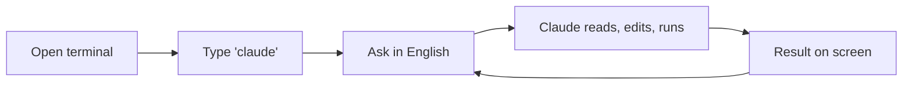

# Claude Code Cheatsheet

> One page. Print it. Stick it next to your monitor. · Checked 25 November 2026.

---

## What you're doing



---

## Install (one line)

| Computer | Paste this |
|---|---|
| Mac / Linux | `curl -fsSL https://claude.ai/install.sh \| bash` |
| Windows (PowerShell) | `irm https://claude.ai/install.ps1 \| iex` |

Verify: `claude --version` · Update: `claude update` · Diagnose: `claude doctor`

---

## Daily commands

| Command | What it does |
|---|---|
| `claude` | Start a session in the current folder |
| `claude "summarize feedback.csv"` | One-shot prompt, then exit |
| `claude -c` | Continue the most recent session |
| `claude --resume` | Pick a past session to resume |
| `claude --resume <name>` | Resume a session you named with `/rename` |
| `Esc` | Stop Claude mid-action, keep the work so far |
| `Esc` `Esc` | Open the rewind menu (undo files and/or conversation) |
| `Shift+Tab` | Switch mode: auto / Manual / Plan |
| `Ctrl+C` | Cancel / exit |

---

## Slash commands (most useful)

| Command | Purpose |
|---|---|
| `/init` | Create a `CLAUDE.md` for the current folder |
| `/plan` | Plan Mode – propose steps, wait for approval |
| `/clear` | New conversation (keeps `CLAUDE.md`). Use between unrelated tasks |
| `/rewind` | Undo: roll files and/or conversation back |
| `/btw <question>` | Side question that doesn't clutter the session |
| `/code-review` | Fresh-eyes review of your changes |
| `/usage` | Cost so far and plan limits |
| `/model` | Switch model and thinking effort |
| `/permissions` | Allow, ask and deny rules |
| `/skills` | List your skills |
| `/doctor` | Check setup, suggest `CLAUDE.md` cuts |
| `/powerup` | Short interactive lessons on features |
| `/help` | List all commands |

---

## What a project folder looks like

```
project/
  CLAUDE.md                 # the note for Claude
  .claude/
    settings.json           # team settings (commit)
    settings.local.json     # personal overrides (gitignore)
    skills/<name>/SKILL.md  # reusable prompts, called with /<name>
    agents/                 # project-specific helpers
  CLAUDE.local.md           # your personal notes (gitignore)
```

---

## `CLAUDE.md` skeleton

```markdown
# Project: <name>

## What it is
One paragraph.

## Tech / tools
- Language, framework, key libraries

## How to run
- `npm run dev`
- `npm test`

## Conventions
- Code style, naming, commit messages

## Gotchas
- Auth quirks, env vars, flaky tests
```

Keep under 200 lines. Only what Claude can't work out from the files. Place at repo root. Commit it.

---

## Five killer patterns

1. **Drop & summarize** – customer-feedback CSV, GA4 export, interview transcript → themes in 30 seconds.
2. **Repurpose** – one long form (blog, deck, podcast transcript) → many short forms in your voice.
3. **Brand-voice drafting** – headlines, social posts, email subjects that already sound like you.
4. **Edit & tone-check** – flag banned phrases from `CLAUDE.md`, suggest tighter alternatives.
5. **Localize without losing brand** – translate campaigns; voice and glossary preserved.

> **Working on code?** The same five patterns apply: analyze logs, generate tests, refactor with `/plan`, fix stack traces, `/code-review` before pushing.

---

## When stuck

| You see | Try |
|---|---|
| Mac says "command not found: claude" | Restart terminal, run `which claude` |
| Windows says "claude is not recognized" | Restart terminal, run `where claude` |
| Windows says "running scripts is disabled" | Run `Set-ExecutionPolicy -Scope CurrentUser RemoteSigned` |
| Login loop | Run `claude auth logout`, then `claude` |
| Claude is heading the wrong way | Press `Esc`, redirect. After two failed corrections: `/clear` and a better prompt |
| Want to undo Claude's edit | `/rewind` (or `Esc` twice). Git as backup: `git diff`, `git checkout -- <file>` |
| Claude asks permission too often | `/fewer-permission-prompts` |
| The answer isn't good enough | First give Claude a check to run, then raise the effort level in `/model`. Switch to a bigger model last |
| Claude keeps ignoring a rule | Make it a deny rule in `/permissions`, not a line in `CLAUDE.md` |

---

**Full guide:** [README.md](README.md) · **Best practices:** [docs/05](docs/05-best-practices.md) · **Official docs:** [code.claude.com/docs](https://code.claude.com/docs) · **Tips:** [claude.dev](https://claude.dev/)
