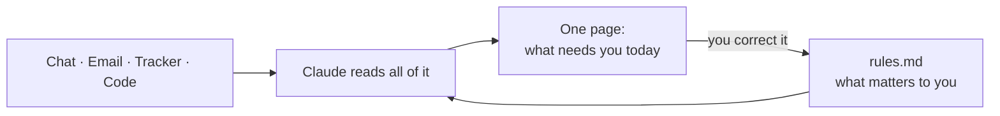

# 6. For CTOs and Team Leads

> **Time:** 4 min · **Goal:** Use Claude as a chief of staff, not as a code generator.
>
> Works in Claude Code and in the desktop app (Cowork). You need your tools connected: chat, email, task tracker, code hosting. See [MCP and connectors](https://code.claude.com/docs/en/mcp).

---

## The big idea

A leader's problem is not writing code. It is reading everything, so nothing important is missed. Dashboards don't solve it: they show everything and leave the finding to you.



Claude reads the stream. You read one page. Every correction you make becomes a rule, so tomorrow's page is better than today's.

---

## Prompt 1 – The daily pulse

```
You are my chief of staff. I am the CTO of [company].

Read what is new since the last pulse in chat, email, the task tracker and the code host.
Give me one short list, most urgent first. For each item:
- risk: HIGH, MEDIUM or LOW
- who and what, in one line, with a link to the source
- what you would do: reply (show the draft), forward to an owner, or nothing

Add "No rule matched": items you could not classify.
Add "Filtered out": five random items you decided I don't need. I use it to catch your mistakes.

Do not send, post, edit or close anything. Drafts only.
Keep a file rules.md. When I correct you, write the correction there with today's date, and read the file before every pulse.
```

## Prompt 2 – The anomaly sweep

You don't look for tasks. You look for what is off. Say it once, then let Claude do the walking.

```
Sweep the task tracker and report only anomalies:
1. User feedback that nobody has picked up – with age in days.
2. Work in progress without an estimate.
3. Tickets with no update for more than 5 working days.
4. Tickets reopened more than once.
5. People with more than 5 items in progress.

For each: link, owner, how long, and one line on what I should ask.
Then "Other things that look odd": anything unusual that fits no rule above.
```

## Prompt 3 – Blind spots

```
Act as an experienced CTO reviewing my blind spots.
1. List what someone in my role should be watching: delivery, quality, people, customers, cost, risk.
2. For each area, say what you can see from my connected sources and what you cannot see at all.
3. Find contradictions between sources, things that should have happened and did not, and what changed since last week.
4. End with five questions I am not asking and have no data for.
```

---

## Don't know your rules? You do.

Open your tracker or chat and walk through it out loud for ten minutes: *"why is this not estimated", "nobody answered this user", "he has too much in progress"*. Each remark is a rule. Have Claude write them into `rules.md`. Most leaders dictate fifteen rules in one sitting.

---

## The autonomy ladder

Don't start with an agent that answers for you. Climb one step at a time.

| Step | Claude does | You do |
|---|---|---|
| 1. Read | Reads everything, writes the one page | Read the page, correct it |
| 2. Sort | Labels risk, says what it would do | Check its judgment for two weeks |
| 3. Draft | Writes replies and follow-ups in your voice | Approve or edit, then send |
| 4. Act | Sends by itself, only in classes you named | Review the log |

- **Move up a step** only when Claude's choices have matched yours for two weeks.
- **Safe first classes for step 4:** acknowledgements, status answers, reminders, routing to an owner.
- **Never automatic:** money, hiring, deadlines, promises to customers, legal matters, judgments about people.

---

## What it changes, and what it doesn't

- **It frees your time.** One page and a few approvals replace an hour of opening every channel.
- **It keeps promises from being lost.** Claude remembers what you asked for and reports "done / not done" the next day.
- **It does not reduce your load when everything is on fire.** Three HIGH items still need three decisions from you.
- **It does not fix the team's output by itself.** Fewer bugs and faster delivery come from how the team works: tests, review, and [a check Claude can run](05-best-practices.md).

---

## Safety for a team

- **Company work in company accounts.** With personal accounts you can't remove access when someone leaves, and the work leaves with them.
- **Know what leaves your machine.** A linked local folder stays on your disk, but whatever Claude reads from it is sent for processing.
- **Give the least access that works.** Start read-only. Add the right to send or write when you reach step 4.
- **Rules that must hold go in settings, not in prompts.** Use deny rules in `/permissions`, or [managed settings](https://code.claude.com/docs/en/settings) for the whole team.
- **Say when a reply was written by the assistant,** and stop two assistants from answering each other.
- **Pick the plan by the evidence you need.** Team and Enterprise differ mainly in audit logs, retention settings and automatic offboarding. Compare on the [pricing page](https://claude.com/pricing).

---

**Back to:** [README](../README.md) · **Previous:** [Best practices](05-best-practices.md)
